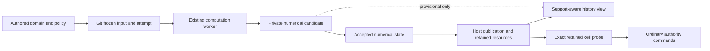

# Adaptive cell histories and computation

The P7 continuum extension uses the existing domain, computation, resource and
Git boundaries. Its schema and backend describe periodic one-dimensional scalar
diffusion. The reusable `foundation.adaptive_fields@1` contracts describe cell
support, interpretation, retained history and exact consumers. Neither changes
the fixed-width meanings of the existing field or channel contracts.

## Identity and physical interpretation

A support records the physical region, space, frame, axis, length and area,
the base partition and ordered dyadic lineage. Each cell's identity is derived
from its region and lineage `(base, level, offset)`, never its current array
position. The complete partition has no gaps or overlaps and satisfies the
periodic two-to-one balance rule.

An interpretation binds that support to explicit cell-average components. Each
component identifies its originating field, exact unit contract and linear or
interval quantity kind. Point quantities with an affine origin are not admitted
as these conserved cell averages. Changing support creates a new epoch.

A history is one immutable, complete bounded index of epochs and array chunks.
It does not contain a linked chain of previous root objects. Each sample has
an exact integer tick, accepted step, epoch and physical time. Its vector has
the shape of that epoch's support. A reader validates chunk ordering, complete
coverage, lineage, finite values, physical meaning and transfer correspondence
before exposing a slice. The maximums are 512 cells, eight components, 256
samples, 32 epochs, 64 chunks and 1,024 resources in a portable closure.

The version 1 wire details remain fixed:

- Qualified logical types are `cell_support`, `interpretation`, `history`,
  `transfer`, `decisions` and `preview` in `foundation.adaptive_fields@1`.
  Area/concentration unit definitions come from the ordinary
  `foundation.adaptive_fields.units@1` bundle and its SI dependency closure.
- Lineage is a finite float64 matrix with `(base, level, offset)` columns, all
  exact nonnegative integers, with maximum level five. This represents the
  full 512-cell limit without violating the metadata decoder's 256-item limit.
  Coordinate faces derive from lineage and length; there is no duplicate
  authored geometry array.
- Chunk rows are `(tick, step, cell-major components...)`, with no single unit
  assigned to those mixed columns. Mesh changes have one accepted instant,
  without duplicate samples or implicit interpolation.
- Transfer v1 means limited linear dyadic refinement and volume-weighted
  restriction. A different mapping is invalid even if its reported mass
  residual is zero; the reader recomputes the actual method.
- Decision arrays contain at most 9,216 rows with the exact `DECISION_COLUMNS`
  vocabulary. Extending a retained history preserves prior sample metadata
  and prior decision bytes.
- Individual metadata records are at most 64 KiB; the complete interpreted
  closure has at most 2 MiB of metadata; each finite NPY array is at most
  4 MiB. Actual encoding/admission may reject a policy that exceeds a bound.
  No old field/channel limit is increased. Returned samples are read-only copies.

## Numerical state and evidence

The initial resolution record retains each partition used to integrate the
authored Fourier initial condition, its actual cell integrals, indicator and
work. This initialization is not mislabeled as a numerical prolongation of
coarser data. Runtime support changes instead retain explicit before/after
interpretations and vectors, the indicator, exact accepted instant, method and
conservation residuals. Readers recompute the conservative transfer checks.

The decision log distinguishes evaluated spatial indicators from skipped
decision opportunities. Work includes rejected temporal candidates, indicator
visits and transferred cells. Dwell and hysteresis counters belong to the
complete numerical state and to checkpoints, not authoring commands.

The finite-volume controller owns immutable accepted states. Candidate arrays
and unflushed buffers are private. A yielded resource is retained only after
the existing host acknowledges its verified bytes, descriptor, publication and
attempt association. Cancellation discards unsampled private buffers and restores
the matching sampled controller boundary before publishing a final checkpoint.

Checkpoints require the exact authored dependency closure, method and numerical
environment identity. They include the support, sampled state, decisions, quiet
and age counters, proposed next step, rejection/work totals and future schedule
cursors. Incomplete state, a different policy or inconsistent history is an
explicit diagnostic. The initial sampled checkpoint at time zero is valid.

A fresh host can resume from copied resources after the producer exits. Resume
creates a distinct attempt; transformed or numerical state never becomes a
second editable domain model. Cancelling between ordinary chunk boundaries can
change the final chunk packaging while preserving every exact accepted sample,
support and decision. Regular checkpoint continuation preserves the final root
when chunk boundaries coincide.

## Presentation and exact consumers

The workbench's adaptive-cell panel prepares immutable presentation data in one
background executor. At most one task and one replaceable request exist. Source
attachment, attempt/input identity, revision and request generation guard every
delivery. Resource reads, interpretation checks and consumer resource copies
stay outside GUI handlers. The reader cache is bounded to 64 MiB.

Playback selects exact retained samples. Cells show their own intervals, levels,
identities and averages. When a selected cell disappears after coarsening, it
remains explicitly absent; the panel disables its probe action until the user
selects an existing cell. Historical origins never select objects in a different
current editor merely because the local revision number matches.

Previews are bounded reductions carrying independent complete-support digests
and exact lineage for both base and candidate. The numerical checks have passed,
but publication is pending. The view labels this distinction and never advances
retained time because a preview arrived. A retained base is checked against its
actual values, position and support. Stale attempt/input/physical interpretations
are rejected. Reduction density cannot change complete-support identity.

An exact probe is an ordinary authored domain model containing the retained
history reference and `(sample, epoch, cell identity, component identity)`.
Its resource closure is copied before ordinary typed commands are submitted.
Undo/redo, conflict checks and fork-before-edit therefore use the existing
authority. The probe backend reads only immutable resources and returns typed
quantities with origins. It requires neither the producing worker nor its old
worktree.

## Scope and qualification

The numerical specification and independent reference criteria are in
[P7_CONTRACT.md](P7_CONTRACT.md). The saved example is
`examples/physical/adaptive-diffusion/project.json`; the independent process
proof is `tools/prove_adaptive_physics.py`.

This is the P7 continuum slice. Particle–continuum exchange, engine state
recovery and statistical hybrid qualification remain separate required gates.
The accepted P0–P6 receipts and archive remain intact while P7 is implemented.
