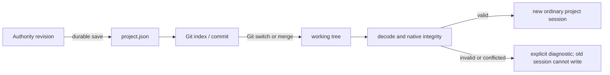

# Git integration

Git owns repository history, branches, the staged index, merges and remote collaboration.
Code Visualizer continues to own the open semantic revision through its existing
`ProjectAuthority`. There is no semantic version-control format, three-way object merge,
rendered-view reconciliation or second canonical model.

## Desktop workflow

Open **View → Git** or **Open Git** in the command palette. Git must be installed and
available on PATH. Save a project before initializing a repository. A project already
inside a repository uses that repository. Initialization creates no commit and adds
the local recovery directory to the new repository's local exclude file.

The Changes tab shows index and working-tree status, untracked files and conflicts.
Select individual files, inspect the working or staged diff, then stage or unstage.
**Commit staged files** commits the reviewed index with the supplied message; it checks
the index fingerprint again before committing. Changes outside the open project are
visible but cannot be staged here or accidentally included in a project commit.
Use another Git client to manage unrelated repository files.
The text conflict/untracked-file editor accepts files up to 2 MiB; Git inspection
output is limited to 16 MiB. Binary or larger files can be reviewed/resolved with an
external Git tool, then refreshed and validated in the workbench.
The fingerprint check is immediately before the standard Git commit operation. An
independent external client can still modify the Git index concurrently; finish that
client's staging operation and refresh this review before committing here.

History shows actual commits and their file patches. Branches / remotes offers local
branch creation and switching, merge, remote configuration, fetch, fast-forward pull
and push. Network operations run only when requested. Authentication uses the installed
Git configuration; terminal prompts are disabled. Configure credentials in your Git
client when interactive authentication is needed. No forced push, hard reset, automatic
stash or implicit commit is performed. Explicit **Freeze & Run** uses the separate
input transaction described below; it does not commit the user's staged index.

Switch, merge and pull require a saved canonical revision and clean repository working
tree. Merge uses Git's `--no-ff --no-commit` review boundary: even a conflict-free merge
is reviewed before an explicit merge commit. Pull fetches the chosen configured remote
branch, checks the incoming recovery-state boundary, and accepts only a fast-forward.
Divergence is explicit; fetch and merge can then be used deliberately.

The conflict editor displays Git's base, ours and theirs plus an editable result. A
resolved `project.json` must decode and pass native integrity validation before staging.
Unresolved conflicts, malformed JSON or broken canonical references prevent reload.
The previous in-memory snapshot stays available with writes blocked. Resolve the files,
then choose **Reload validated project**, or abort the merge. Schema/language constraints
that represent valid but incomplete authored work remain normal build diagnostics.

## Save and session boundary



An external checkout or replacement of `project.json` blocks semantic commands, undo,
redo, autosave and generated artifact publication from the stale session. The host then
retires that session and admits the validated file through the existing session lifecycle.
Interactive debugging retires with its editor. Host-owned scientific attempts and
their retained resources survive replacement; a new attachment cannot receive old
runtime overlays, including when two branches share a local revision number.

Local undo journals are recovery data, not Git history. At a Git revision boundary they
are retained under `<local-state>/git-history/<identity>/` and are excluded from recovery
selection. This prevents a larger revision number from a previous branch resurrecting
its contents after checkout. Only validated paths inside the project state directory
are archived; Git-tracked state is refused, including tracked state in an incoming tree.
Lease and other local state are not moved. Git's own history remains intact.

`git-checkpoint.json` records Git HEAD and the digest of the last successfully saved
native file. A same-HEAD external restore is therefore a new recovery boundary too.
A crash after durable journal append but before native-file publication leaves the
previous file/checkpoint pair intact, so the newer journal still recovers normally.
The checkpoint is local session metadata, outside native project persistence.
On first adoption, an untracked `project.json` under an ancestor Git repository keeps
ordinary journal recovery, including recovery from a damaged or missing native file.
Git has not owned that file. A tracked native file with no previous checkpoint instead
establishes the selected working file as the initial boundary; its unmarked local
history is retained in the archive rather than automatically promoted. This conservative
first-adoption policy prevents an unknown older checkout from being replaced by a
larger historical revision number.
No format revision is required for Git itself. Desktop, headless and CLI reads all
recognize checked-out files as explicit snapshots rather than lower-priority recovery
candidates. An existing saved project can still contain recoverable local edits on the
same Git revision.

## Automation

`git.status`, `git.diff`, `git.history`, `git.commit_diff`, `git.branches`, `git.remotes`
and `git.conflict` require READ. Writes reject proposal mode and require EDIT + SAVE.
Stage, unstage and commit use those grants; repository, branch, conflict, reload and
remote operations additionally require ADMIN. All methods operate through a host-attached
`GitProjectController` and the same active session.
The CLI `rpc` command and MCP `git_operation` tool forward these same methods and grants.

Mutation requests carry `expected_head` from the reviewed status; commits also carry
`expected_index`. File paths are repository-relative and restricted to individual files
inside the open project. Remote operations take a configured remote name. Example:

```json
{"method":"git.stage","params":{"paths":["project.json"],"expected_head":"<reviewed HEAD>"}}
```

The desktop and `serve` host reopen the session after a valid working-tree change.
Existing automation connections are retired at that boundary; reconnect to the host's
published endpoint and subscribe to the newly opened revision. During an unresolved
merge the endpoint remains available for inspection and explicit resolution while
semantic writes are blocked. Embedders must attach a controller and implement the
same host reload callback. After a controller publishes an ordinary loaded session,
automation follows that authority and reattaches its event subscription; queries
do not load projects or reconcile branches. Predecessor proposals are discarded.

## P2 Freeze & Run

Choose a backend/root in the Domain Workbench and select **Freeze & Run**. Declare
any additional UTF-8 source files in the Git panel as
`repository/path.py => runtime/path.py`. Git captures only native project data,
the input manifest and these files, using an empty private index. Resource bytes
are verified and retained outside the worktree. The original HEAD, raw index and
unrelated work remain intact. The Git panel opens on the selected actual experiment
branch/worktree after capture. No network access or remote publication is implicit.

The input commit, retained per-attempt ref and durable ready record precede
execution. The first accepted semantic edit forks once from that frozen input;
later edits stay on the unrun variant. Presentation and unsubmitted text do not
fork. Undo/redo use the same accepted-candidate boundary and native journal.
Identical reruns allocate distinct attempts against the same input commit.

The **Retained runs** tab opens old inputs/evidence, inspects incomplete operations
and removes only clean inactive owned worktrees. Branch names and worktree lifetime
do not own the retained input refs or resource store. Recovery never automatically
replays execution. See [the transaction contract](GIT_EXPERIMENTS.md) for precise
closure, limits, checkpoint compatibility, automation fields and failure states,
and [the acceptance map](P2_ACCEPTANCE_MAP.md) for verification status.

## Implementation and proofs

`application/git.py` uses argument-vector Git subprocesses, machine-readable porcelain
status, literal pathspecs, bounded inspection output and disabled external diff/textconv
helpers. `application/git_service.py` defines session-aware use cases; the Qt dock and
permission-checked RPC methods are adapters. Git operations are filesystem lifecycle
operations, not a second semantic command bus.

`tests/test_git_workbench.py` uses real isolated temporary Git repositories to prove
staging and commit review, lower-revision branch reopening, stale edit protection,
conflicts and explicit merge commits, path boundaries, configured local bare remotes,
fast-forward and divergent pulls, permission grants and the desktop review surface.
The existing architecture, generation/session and automation suites remain regressions.

Git behavior follows the official [status porcelain format](https://git-scm.com/docs/git-status),
[merge options](https://git-scm.com/docs/git-merge) and
[switch behavior](https://git-scm.com/docs/git-switch).
