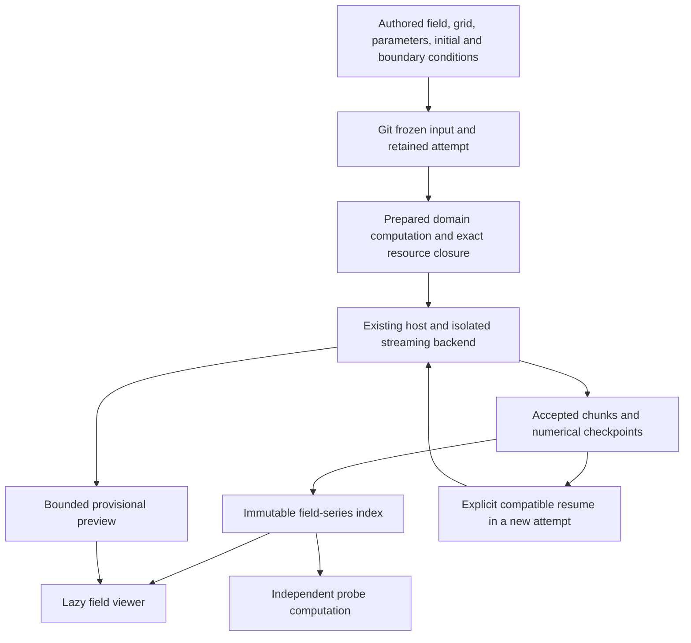

# P5 implementation plan: time, fields and checkpoints

Status: **source and packaged gates verified; acceptance review open**, 13 September 2026.
The complete run on `6d44a6f` passes **2,122/2,122**, including all 2,027 unchanged
P4 cases, with zero failures/errors/skips in 5,581.52 seconds. It uses the explicit
user-authorized restricted-host field-heartbeat ceiling of 350 ms and a verified
50% CPU allocation. Measured heartbeat is 122.0 ms; interaction and memory bounds
pass unchanged. Normal-profile heartbeat remains 250 ms. Earlier failed runs are
preserved independently; this does not reclassify them.

The field-future ownership correction and the autosave/publication lifetime
correction both pass their new reproductions and the complete existing suite.
P2 recovery, actual killed-host checkpoint resume, persistent publication failures,
retained numerical convergence, saved-source proofs and desktop controls pass.
Ruff, formatting, mypy, generated protocols and dependency checks pass. Fresh
isolated-wheel and native CLI/GUI proofs pass, including the saved CAD/field
compositions, portable restart and unchanged native P2 history. The original
external review passes 16 affine and 11 recovery cases, retaining its two Windows
LF/CRLF fixture failures. The [structured receipt](receipts/transition-p5.json)
records exact source, package and profile identities. Exact extracted-source
qualification accompanies the delivered ZIP in `programmodel.verification.json`.

The original implementation scope below is retained, with the explicitly documented
restricted-host allowance. See the [P5 acceptance map](P5_ACCEPTANCE_MAP.md),
[complete analysis](receipts/p5-verification-2026-09-12/full-regression-10-analysis.json)
and [historical corrections](receipts/p5-verification-2026-09-12/README.md).
The committed planning receipt remains historical. P5 acceptance is open and
P6-P8 remain outside this implementation.

## Accepted input and scope

P4 delivery commit: **60ed00b56f101cf2025bc1bb2ae47e6e33f59c02**.
Tested application/source commit: **7d77a32e56aeb3a62c628e184ee3e50510359230**.
The [user acceptance record](receipts/p4-acceptance-2026-09-12.json) preserves its
Windows x64 / CPython 3.13.15 qualification. The accepted programmodel.zip is
12,813,544 bytes, SHA-256
**1f5c678ca33d1fcde1b55bd2baed27a733eb5d0188d188953668c2705b8fd054**.
Keep that ZIP, sidecars, failed/passing receipts and every old test unchanged
during planning. P4 has 2,027 recorded passes; this is a baseline, not a P5 result.

Deliver one usable loop: author a small diffusion experiment, freeze it with Git,
observe its evolving scalar field, inspect old slices while it runs, cancel,
restart the host, explicitly resume a compatible checkpoint, and independently
check the retained result without rerunning its producer. Parameter edits retain
P2 fork-before-edit behavior. Solver steps and display refreshes never make branches.

Use one-dimensional constant-coefficient diffusion as the first physical problem.
It exercises spatial support, units, time, publication, storage and recovery in
one example with an analytic reference. Keep nonlinear/DAE solvers, general PDEs,
unstructured/CAD meshing, automatic frame transformations, changed-input state
transfer, coupling, adaptive spatial resolution and P6-P8 outside this phase.
No new execution engine, authority, project format, universal physics model or
foreign-language framework is needed.

## What already exists, and the actual gaps

| Existing boundary | Preserve | P5 work |
|---|---|---|
| ProjectAuthority, DomainWorkspace and ProgramModel | One owner per authored meaning; typed commands, undo/redo and semantic identity | Ordinary field/problem/grid/time-policy domain intentions; no node per sample |
| RegisteredBackend.stream, BackendExecution and ComputationService | The existing process, cancellation, progress and GUI/headless lifecycle | A streaming numerical adapter and a typed, coalescible preview update in that lifecycle |
| ProducedResourceEvent and sealed publication acknowledgment | Durable bytes and receipts before the worker can rely on admission | Accepted field chunks, bounded index resources and checkpoints using the same admission path |
| ResourceStore, ResolvedResource.open and transfer protocol | CAS hashes, managed file ownership and existing byte limits | Registered interpretation of composite resource dependencies and lazy/file-backed access |
| ResumeCheckpoint, CheckpointContract and bind_checkpoint | Exact retained parent, sealed resource/type and conservative source-closure compatibility | Backend validation of actual numerical state and fresh-process restart proofs |
| RetainedComputation and ExperimentStore.interrupted | Frozen protection before admission; honest interrupted attempts after recovery | Checkpoint/prefix retention and failures at every publication/resume boundary |
| QtRuntimeObserver and CAD attachment tokens | Background preparation and rejection of obsolete/same-revision results | A field slice/history view with independently labeled accepted and trial states |

Three implementation facts require explicit treatment. Resource capture currently
walks references in Python values, not inside resource payloads. Small resolved
resources are read eagerly, which would load a history assembled from many small
chunks. Publication receipts have a cumulative 2 MiB budget per attempt, and live
observations become terminal evidence. A history cannot be implemented by hiding
child references in JSON, loading every chunk, or emitting an observation per sample.

## Ownership and the execution loop

Definitions own physical parameters, field quantity kind, units, frame references,
grid policy, initial/boundary conditions, time interval, numerical step policy,
sampling and checkpoint policy. The prepared computation owns the derived grid
and numerical interpretation. The worker owns mutable vectors and unsealed chunk
construction. Resources own immutable samples and restart state. Evidence records
what was established. Camera, playback cursor, selected slice and color scale
remain presentation state. Runtime values never overwrite authored parameters.

Keep three distinctions explicit: solver-accepted state, durably published accepted
state, and successful completion of an attempt. A cancelled attempt can retain a
valid published prefix; a full-looking file is not proof that its producer succeeded.
Default downstream success bindings retain P4 behavior. Explicit inspection or
consumption of a selected sealed prefix is a separate operation.

## A. Freeze the field, temporal and compatibility contracts

Use ordinary versioned first-party bundles, provisionally foundation.fields@1 and
code_visualizer.diffusion@1. All public IDs are namespace-owned with separate
versions. Field/grid/axis/boundary IDs remain project-scoped. Register new unit
definitions through foundation.units and its existing algebra; do not teach
CanonicalValue or DataResource what temperature or diffusion means.

The new example needs real authored space/frame references. foundation.space@1
currently requires foundation.math@1, while the P3 algebra uses math@2. Add an
explicit space@2 contribution compatible with math@2, retaining the old space@1
schema, bundle and notation identities for old projects. New notation registrations
must be unambiguous. Do not silently rewrite installed space@1 or introduce a
second private frame model. No migration of old projects is necessary for the new
example; any later migration must be explicit and preserve object IDs.

Define closed, versioned field-domain records before implementing the viewer:

- **Field interpretation:** source field ID, quantity kind (linear/interval/point),
  exact unit contract, scalar component identity, spatial support resource, authored
  space/frame/axis identities and their frozen interpretation, node/cell association,
  dtype/shape, validity-mask policy and interpretation version. The first solver
  supports scalar, node-associated data on a uniform 1D Cartesian grid. Other
  interpretations must be rejected or preserved as unsupported, never guessed.
- **Temporal position:** physical time with unit, integer accepted-step index and
  sample index, distinct from transport sequence and operational wall time. A
  trial also names the accepted state from which it was computed and its candidate
  time/step. Multi-channel frames require one common state/time/interpretation key.
- **Series index:** exact interpretation/support references, ordered immutable chunk
  references, covered sample/time ranges and any explicit parent prefix. Index
  versions are new resources. Coverage, gaps, overlap, order and child hashes/types
  are validated. There is no mutable file named latest used as scientific input.
- **Checkpoint:** accepted step/time and full numerical vector, method/state-format
  version, exact base input compatibility digest, grid/unit/frame/condition contracts,
  numeric dtype/library identity, output/checkpoint cursors and acknowledged prefix
  reference. Store arrays in resources. Do not pickle solver instances or depend on
  a library's private integrator internals.

Introduce a small coalescible PreviewEvent in the existing backend/worker/runtime
union. Its registered interpretation validates a closed domain preview record;
use existing typed canonical values and bounded named fields, not arbitrary JSON,
Python callbacks or protobuf Any. For the scalar proof, that record names the
field/support interpretation, accepted state, candidate step/time, sampled indices
and values. Small preview tensors stay within the existing 1,024-element/64 KiB
canonical bounds; use at most 256 plotted values. They are explicitly reduced
previews, never authoritative full fields or checkpoints. The host validates source
origins and session sequence, retaining only the newest preview per attempt.
Provisional updates do not accumulate in evidence or consume publication receipts.

New preview wire fields/messages must have explicit version checks and golden
tests. Existing v1/v2 request, backend, terminal, evidence, publication and resource
bytes remain exact when new behavior is absent. Keep ordinary in-process calls
as Python calls. Add only the portable event support required at an actual boundary.

**Exit:** schema/quantity-kind/frame diagnostics, malformed temporal records,
old/new codec goldens, missing/ambiguous contracts and architecture tests pass.

## B. Resource closure, chunks and lazy reads

Add a read-only resource-interpretation contribution at the existing static bundle
registry. An exact logical type/version selects a trusted, bounded metadata decoder
that exposes typed child resource references. A shared closure walker uses it for
publication admission, freeze input capture, managed-worker/portable preparation,
retention and project recovery copying. The CAS store itself does not interpret
fields. Missing interpreters block operations that promise complete closure while
preserving the data. Duplicate interpreters fail deterministically.
Keep interpretation/composition in the application/extension boundary; persistence
can receive the resolved references instead of importing application behavior.
Do not reverse existing domain or persistence dependency direction.

Verify parent and child hash/type/size claims, deduplicate by exact identity, reject
cycles/conflicting identities and impose traversal/count/metadata bounds. Publish
children before a parent that references them. A parent receipt cannot be
acknowledged before all its required children are retained. The existing worker's
claimed-transfer checks must understand this declared closure, not allow unsolicited
files or infer dependencies from paths. Exercise nested resources by copying only
the selected root closure to a fresh store, then removing access to the producer
store and working directory.

Use separately sealed, fixed-size numeric chunks, initially bounded .npy float64
arrays with allow_pickle=False, exact dtype/shape/length checks and explicit header
limits. Use read-only file/memory-map access; never edit a published mapping.
Metadata and physical meaning live in the closed field records, not inferred from
an array's shape. NumPy documents both [bounded-load options](https://numpy.org/doc/stable/reference/generated/numpy.load.html)
and [memory-mapped .npy access](https://numpy.org/doc/stable/reference/generated/numpy.lib.format.open_memmap.html).

Extend existing resolved-resource access so a history consumer can retain managed
file handles/descriptors instead of eagerly reading every sub-64-MiB chunk. Share
this policy across local preparation, the actual worker and portable replay.
Keep native backends' existing input expectations covered by regressions. Hashing
the declared closure during admission may scan data off-thread; opening a view or
moving its cursor must not rescan/load the entire history.

First supported bounds: chunk payload <=4 MiB, metadata page <=64 KiB, bounded
index pages with <=256 entries, and a 64 MiB field-view data cache. Respect the
existing 2 MiB envelope and cumulative publication/transfer-metadata budgets,
256 KiB transport chunks, 1,024 request-resource limit, 4,096 transfer-count limit
and 2 GiB phase-transfer limit. Preflight expected closure, chunk, index and
checkpoint publication counts for the selected finite experiment. Reject over-budget
requests before solving; do not increase old limits or weaken their tests.
Sealing/transferring a child chunk is distinct from issuing an EvidencePublication:
publish selected index snapshots and checkpoints, not a separate receipt for every
child. Extend the existing resource-output transfer to admit a bounded root and
its declared children together. Root admission claims only those children and
acknowledges the complete closure. This lets a history contain many chunks without
duplicating its full provenance in a receipt per chunk.
Live frame sampling, chunk sealing and checkpoint intervals are distinct. Keep
many samples in each chunk and only small summary/root references in final evidence.
Longer-than-supported runs receive an explicit limit diagnostic; unbounded detached
simulation and an unlimited publication journal are not P5 prerequisites.

**Exit:** valid nested closure copies/replays, missing/corrupt/swapped children,
undeclared transfers, partial sealing, budget overflow and instrumented lazy reads
pass without changes to old receipt-limit expectations.

## C. Real diffusion and independent consumption

Implement a statically registered streaming backend over ordinary diffusion
intentions. Its supported equation is du/dt = D d²u/dx² with constant positive D,
fixed uniform grid, zero Dirichlet endpoints and a declared sine initial profile.
u is a linear or interval scalar; the temperature example is a temperature
**difference**, not an absolute temperature. Reject affine-point input to this
fragment. Use P3 quantity-kind and dimensional algebra for D, coordinates, time,
amplitude and boundary values. Equivalent mm/ms/temperature-interval inputs must
produce the same SI interpretation. No expression evaluation from strings.

Use second-order centered spatial differences and fixed-step Crank-Nicolson.
Use SciPy's existing [banded linear solve](https://docs.scipy.org/doc/scipy/reference/generated/scipy.linalg.solve_banded.html)
for the tridiagonal system; keep finite checks. This is a bounded numerical adapter,
not a new symbolic or general PDE engine. For this initial fragment enforce
D*dt/dx² <= 0.5, making the supported nonnegative sine-data behavior explicit.

An explicit predictor can be part of the correction formulation: p=u+dt*A*u;
solve (I-dt*A/2)*delta=(dt*A/2)*(p-u), then candidate=p+delta. The predictor is a
real, labeled trial of the step, not an animation presented as solver progress.
Accept the corrected state only after finite/boundary/residual checks. A failed
check leaves the previous accepted state intact and ends with a diagnostic.
Emission frequency and slow rendering cannot change the numerical timestep.

Predeclare the numerical proof before running the implementation:

| Input/reference | Value |
|---|---|
| Domain length, diffusivity, initial amplitude, final time | 1 m; 0.1 m²/s; 10 K interval; 1 s |
| Independent continuous solution | u(x,t)=10 exp(-0.1*pi²*t) sin(pi*x) K interval |
| Final midpoint reference | 3.7270783885343794 K interval |
| Spatial refinement pairs (nodes, steps) | (33,512), (65,2048), (129,8192) |
| Required finest-grid max error | <=2e-4 K interval |
| Observed spatial order | log2(E_coarse/E_fine) in [1.9,2.1] for both refinements |
| Separate temporal study | Fix 33 nodes; 512/1024/2048 steps; compare against the exact semidiscrete sine mode, not the continuum spatial error |
| Temporal order | [1.8,2.2], while errors remain above roundoff |
| Step equation residual | normalized infinity norm <=1e-11; record the dimensional residual and its scale |
| Resume versus uninterrupted | max difference <=1e-9 K interval, identical sample coordinates and no duplicate/missing accepted samples |

The independent semidiscrete reference uses eigenvalue
lambda=-4D/dx²*sin²(pi/(2*(nodes-1))) and amplitude 10*exp(lambda*t).
Reference code must not call the backend assembler/stepper. Test extra supported
sine modes and mixed mode data if the implemented initial-condition schema permits
them; otherwise report those inputs as unsupported. Check nonnegativity, fixed
endpoints, decaying discrete norm, equivalent units and source-linked invalid input.
These are planned tolerances, not measurements or solver acceptance claims.

Add a normal field-probe consumer bound to a selected immutable series/frame.
It declares exact sample/time selection, returns a quantity and source origins,
and refuses silent interpolation, clamping, wrong frames or absent components.
Run it in a fresh host after the producer exits and through portable-plan replay.
Publish the native authored example through the normal example catalog and proof
tools; the delivered saved-source proof must forbid example-factory imports.

**Exit:** analytic/convergence checks and the saved-source -> host -> retained
chunks -> fresh consumer loop pass with real NumPy/SciPy and ordinary authority.

## D. Durable checkpoints and real Git recovery

Retain bind_checkpoint's conservative same-base-input rule. Add backend validation
of the complete checkpoint state at every execution surface, including direct
prepared/portable requests. Outer type equality alone cannot admit a checkpoint.
Check exact method/state format, base definition and numerical policy, grid/frame/
units, vector size/dtype/finiteness, accepted time/index, prefix/cursors and parent
provenance. Changed parameters, boundaries, discretization, horizon, interpretation
or incompatible implementation require a fresh run; P5 does not add state transfer.

Checkpoint publication order is: finish an accepted step; seal the required
sample/state resources and prefix; durably associate the checkpoint publication
with the retained attempt; acknowledge it; then advertise Resume availability.
Inject persistent failures at bytes, descriptor, receipt, retained-attempt association
and final-report writes. Existence of an unacknowledged state file cannot enable
resume. Previously acknowledged prefixes/checkpoints survive every later failure.

Explicit resume creates a distinct attempt with parent attempt/publication IDs,
not a reopened worker or relabeled trajectory. Preserve P2's base-compatibility
digest versus complete request/input identity: the checkpoint binding changes the
execution input, not the authored definition. Repeating the same selected resume
input has a new attempt and the same applicable frozen input commit. A chain of
resumes keeps its original compatibility basis and its explicit parent lineage.

Checkpoint only at complete accepted steps. Flush and acknowledge any needed
partial output chunk before sealing checkpoint state. Resume adds a new suffix
and references the immutable old prefix, with no duplicate boundary sample.
Cooperative cancellation can publish the last valid checkpoint. Forced termination
retains only earlier acknowledged state. Host restart marks orphan attempts
interrupted, never successful from file presence, and requires explicit resume.

Use actual dirty temporary Git repositories and separate host processes. Cover
parameter edit during solving, one fork, identical reruns, stale frozen markers,
post-admission failure, same-revision branches, undo/redo, checkpoint chains,
retained-run reopening and clean inactive worktree removal. Keep the original
HEAD/index, unrelated work, old commits and resource bytes unchanged. Interruption
must not reopen permission to edit a frozen definition in place.

**Exit:** uninterrupted/cancelled/resumed/restarted numerical equality, fault
injection, native process lifetime and all existing P2 recovery gates pass.

## E. Coherent field inspection and responsiveness

Add a discoverable field-history panel within Computation and evidence, using the
existing authority, observer and attachment identity. Display the selected accepted
time/step, unit/kind, axis/frame, support hash, source/input digest, run and coverage.
Show a selected history slice, profile and bounded space-time image. Do not require
VTK/PyVista or a new graphics stack for this 1D proof.

Keep separate accepted and provisional display slots. A trial identifies its base
accepted state and candidate time; it never advances the accepted cursor. Admit
all components of a displayed frame together. Reject mismatched source/attempt,
time, support, units/association or stale preview sequence. Reduction and raster
preparation run in bounded cancellable background work. Every completion checks
attachment, request generation, exact resource and source identity before display.
Historical inspection never highlights another branch with the same local revision.

Exercise actual Freeze & Run, Cancel, checkpoint selection, Resume and reopen
controls as well as SDK/automation. Draft text remains intact, semantic edits go
through fork-before-edit, and playback/color/selection changes do not fork.

Stress fixtures must include 16 then 128 roughly 4 MiB field chunks, repeated
nonsequential lazy slices, preview bursts, a real CPU computation and the P4 CAD
view/consumer. Keep fixture output inside existing resource/receipt budgets.
Record cache bytes, opened/decoded chunks, pending tasks, preview queue and process
RSS over time. Proposed incremental field-view working-set growth from the smaller
to larger history is <=64 MiB after native imports/warm-up; the data cache itself
never exceeds 64 MiB. Keep one active and one replaceable pending slice job.
No resource array becomes a tuple of millions of evidence observations or Qt items.

Use the existing reference-machine response gates: interaction acknowledgment
p95 <=100 ms, p99 <=200 ms; no attributable heartbeat gap >250 ms normally.
The user's 13 September restricted-laptop allowance is an explicit P5 test profile
with a 350 ms heartbeat ceiling; all other bounds remain unchanged. Record the
profile and do not infer normal-profile timing qualification from it. Record cancellation
acknowledgment and the existing termination grace/escalation. Run those measurements
without another test suite contending for the same host. Preserve failed samples;
do not extend timeouts or relax numerical/memory thresholds after a failure.

**Exit:** P5-02/03/05 UI and offscreen responsiveness proofs pass alongside the
real checkpoint/restart controls and P4 view isolation tests.

## Intended code locations

New paths below belong to the existing application, not a prototype directory.
Derive final file splits from implementation size without duplicating behavior.

| Area | Existing extension points / intended additions |
|---|---|
| Field and diffusion meanings | extensions/fields/ for foundation.fields schemas, closed resource records and consumers; extensions/diffusion.py for the bounded solver; extensions/foundations/space.py for explicit space@2 composition |
| Static composition | extensions/registry.py, extensions/publication.py and extensions/builtin.py for resource interpreters and exact bundle/contract closure |
| Input/output closure | application/resource_admission.py, application/experiment_inputs.py, generation/computation.py, persistence/computation_resources.py, persistence/computation_terminal.py and persistence/project_resources.py |
| Preview and publication lifecycle | execution/backends.py, execution/lifecycle.py, application/computation_service.py, application/computation_process.py and application/computation_publications.py; additive protocol support under protocol/v1/ |
| Checkpoint and retained history | application/experiment_checkpoints.py, application/retained_computation.py, application/git_experiments.py and persistence/experiment_store.py; retain their existing authority boundaries |
| UI and example | ui_qt field-history panel using existing observers; application examples/catalog; examples/physical/diffusion-field/project.json; normal tools/prove_field_history.py |

No time stepping belongs in ProgramModel, kernel.py, a Qt callback or the Git
controller. No physical field interpretation belongs in the generic CAS store.

## F. Regression, packaging and acceptance review

Use [P5_ACCEPTANCE_MAP.md](P5_ACCEPTANCE_MAP.md) as the executable gate map. After
each checkpoint run its focused tests plus test_architecture_boundaries.py and
test_dependency_layering.py. Do not sum overlapping cohorts. Keep the 2,027 P4
cases and all unchanged external affine/recovery inputs; add meaningful new tests
for the boundaries above. Repeat the complete suite only after a change/failure
justifies it, then bind its exact source inventory to the delivered artifact.

Update architecture, computation/resource/temporal protocol, project-format,
runtime/UI and test-strategy documentation as implementation establishes the
contracts. Deliver FIELD_RESOURCES.md, TIME_AND_CHECKPOINTS.md, a user workflow,
the saved example, a normal proof tool, acceptance map and source-bound P5 receipt.
Use existing wheel/native/archive builders and verification; extend real production
proof lists. Test native CLI and GUI, wheel-isolated imports, portable replay,
extracted source and all 17 old standard examples plus old foundation/P3/P4 proofs.

The inspected P4 environment already contains NumPy 2.5.3 and SciPy 1.18.1. Treat
these as candidate implementation pins, not fresh P5 packaging qualification.
Record and qualify an explicit optional field/science dependency lock at checkpoint
A; keep no-science/no-CAD authoring and missing-backend diagnostics usable.
Do not regenerate protobuf internally between ordinary Python calls. Do not
introduce pickle, eval, dynamic project plugin loading or a parallel solver runner.

Preserve the accepted P4 ZIP and sidecars until a replacement has its own complete
receipt and recoverable Git identity. No P5 pass is inferred from a type definition,
a rendered image, P4 acceptance or the planning calculations. Report Windows
symlink privilege/CRLF controls and missing independent review inputs honestly;
Linux/macOS certification requires actual runs on those platforms.

## Implementation evidence and design corrections

Checkpoint A (12 September): closed field records and previews have focused
coverage; 54 field/preview/architecture cases pass. The first wider cohort found
one old schema-installation regression (133 passed, 1 failed). Registering two
space schemas under the old schema ID made the legacy version-free installation
ambiguous. Space@2 therefore owns the distinct project-scoped schema identity
`foundation.space:algebra_schema`, with the same space concept identities in its
exact math@2 bundle closure. Its public namespace/version remain foundation.space/2.
Old space@1 schema, installation behavior and bytes are unchanged. The corrected
foundation/field/architecture cohort passes 71 cases. This is an explicit dependency
composition, not an implicit upgrade or a fallback to an incidental version.

PreviewEvent is an additive, explicitly versioned worker event. Its trusted backend
registration declares an exact preview interpretation. Existing portable backend
contracts and old request/evidence bytes are unchanged. No provisional event enters
observation or history accumulation; runtime keeps the latest preview only.
