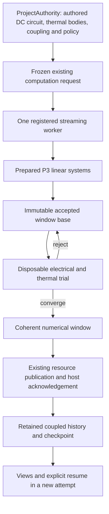

# P6 contract and implementation decision

Status: P6-R1 shared compiler correction verified against the unchanged review,
complete regression, isolated wheel and fresh Windows executables. P6 acceptance
remains pending user review; final extracted-source delivery has matching adjacent
verification/checksum sidecars. See [the current acceptance map](P6_ACCEPTANCE_MAP.md)
and [correction record](P6_R1_CORRECTION.md). Earlier receipts remain historical.

P5 was accepted by the user on 13 September 2026. Its exact archive, historical
receipts and original 2,122 case identities remain the regression baseline. See
[the acceptance decision](receipts/p5-acceptance-2026-09-13.json).

## Source and scope

The input ZIP has SHA-256
`260c1cd82bed4dc3bb9559f3f5c3446261856faee7e1965cbca8c119c29cc863`.
`phase-records/p6-20260913/baseline.json` in the Git repository binds its bytes,
586 qualified source files, old tests and five supplied handoff documents.
Their verbatim copies are under `receipts/p6-input-2026-09-13/`.
The supplied filename is `PROGRAMMODEL_P6_PLAN.md`. Referenced `TASKS.json`,
`BASELINE.json`, `SOURCES.md`, `reference/`, `source-docs/` and `baseline-review/`
were absent from this input directory. They are not represented as executed
evidence. The supplied six-stage table and reference equations, original
transition contracts, and preserved, actually executed P5 review govern this work.

P6 implements a bounded two-body electrothermal experiment and, separately, an
axial structural adapter consuming a solid rectangular-prism CAD resource.
P7/P8, general multiphysics, general FEM and RF remain outside this phase.

## Ownership and derivation

No authored model changes during iteration. DC resistance and thermal right-hand
side bindings are derived coefficients of prepared, unit-checked linear equation
families. The ordinary P3 solver handles each bound immutable `LinearSystem`.
Parameterized compilation is an in-process mathematical facility, not a new
persisted expression language or another execution engine. Existing equation
compilation, linearity, units, origins and numerical checks retain their meaning.

The electrical participant is stateless. A trial owns both thermal temperatures,
endpoint circuit values and residuals; the immutable base owns accepted time,
energy and schedule state. Rejection discards the trial. No cache can substitute
an earlier resistance or RHS. Published data refers to one source/window/time;
neither a provisional preview nor an unacknowledged resource establishes a
durable accepted sample. The existing host owns ACKs, attempts and recovery.

The new `foundation.channels` version 1 interpretation describes named lumped
channels with per-column units, quantity kinds, semantic supports and a common
time axis. It reuses finite float64 arrays and interpreted dependency closure.
It never fabricates a spatial grid. Existing `foundation.fields` version 1 and
diffusion checkpoint bytes remain unchanged. Electrothermal checkpoints and
previews have separately registered exact resource types and versions.

## Scientific fragment and policy declared before testing

Use fixed-window backward Euler for the supplied two-body equations, with bounded
partitioned fixed-point iteration. No adaptive timestep, implicit interpolation,
fallback solver or tolerance relaxation. Both evaluation orders solve the same
endpoint equations from the same accepted base. Initial rises may be nonzero;
ambient is fixed. Temperatures are points, their differences are intervals.

The initial supported SI envelope is finite: absolute temperatures 200..1000 K,
voltage magnitude at most 100 V, R0 0.1..100000 ohm, nonnegative alpha at most
0.1/K, capacities 0.1..100000 J/K and conductances 0.001..1000 W/K. Every evaluated
resistance must be positive; trials outside the temperature envelope fail at the
body/law origin. Duration is positive and at most 100000 s, with 1..100000 fixed
windows and 1..50 iterations per window. Output closure capacity can impose a
smaller limit. Equivalent declared units are converted before these checks.

Normalize component and interface residuals using explicit positive 1 K, 1 W
and 1 J scales by default; convergence requires at most 1e-10. Require absolute
per-window energy imbalance at most 1e-9 J. Check P=VI=I²R and opposite contact
heat signs. Endpoint quadrature increments energy exactly once per accepted
window. These finite tolerances do not promise every parameter combination
converges: budget/range/conditioning failures are explicit failed computations.

Independent tests derive the eliminated backward-Euler root, constant-resistance
matrix exponential, nonlinear steady balance and a separate high-accuracy ODE
reference. Production must not import reference/test/example functions. Compare
decoded published samples for h=1, 0.5, 0.25 s at common five-second times through
100 s: observed order 0.9..1.1 and finest temperature error below 0.02 K. Report
coupling residual separately from time-discretization error.

Axial proof: explicit solid prism, material, axis/frame, immutable support/load
selections and geometry-to-1D idealization; 3..65 nodes. Actual element assembly
uses P3. Geometry predicates use 1e-7 relative/1e-9 m absolute tolerances; positive
length/area required. Analytic comparison uses 1e-8 relative and 1e-12 absolute
in each stated SI output unit. Missing CAD capability is an explicit local
diagnostic. Holes, taper, disconnected solids, bending and unsupported frames
are rejected, not inferred from bounding boxes.

## Durability and performance

Checkpoints contain complete accepted thermal/energy/time state, sampled prefix,
future cursors, numerical/scientific and mapping identities. Circuit state is
recomputed. Resume requires an explicit compatible selection and a new attempt;
no silent state transfer or automatic replay. Git freeze/fork protection remains
authoritative across missing markers, interrupted publication and reopening.

Existing 2 MiB envelopes, 1,024-resource/64-depth closure bounds and resource ACK
semantics remain in force. New metadata is bounded to 64 KiB and array chunks to
4 MiB. P6 view cache and incremental RSS budgets are each 64 MiB; heartbeat
maximum is 250 ms, interaction p95/p99 at most 100/200 ms on the declared
workload. Measure actual raw timing; failure requires correction or an explicit
new user decision. P5's earlier 350 ms restricted profile remains P5-specific.
Builds/tests use the verified existing Windows job-wide four-of-eight CPU affinity
(50%), serial qualification jobs, and pinned dependencies. Unrelated builds
continue. No cross-platform timing or native qualification is inferred.

## preCICE decision

preCICE documents complete iteration checkpoint restoration and advancing time
only after convergence ([official implicit-coupling guide](https://precice.org/couple-your-code-implicit-coupling),
read 13 September 2026). Those requirements inform this adapter's accepted-base
contract. This bounded case has two in-process numerical participants and an
identity interface; introducing another coupling runtime would add no needed
capability. preCICE becomes useful for independently hosted solvers and mesh
mapping, which are outside P6. It is evaluated, not an installed prerequisite.

## Implementation and qualification sequence

1. A: preserve/verify baseline and handoff; record acceptance, contracts and bounds.
2. B: authored components, coefficient binding and independent references.
3. C: real rejected/retried windows, rollback, energy and order invariance; prove
   coherent publication through the ordinary host before expanding the feature.
4. D: bounded history, explicit checkpoint resume, persistent failures, killed-host
   recovery, portability and Git branch isolation.
5. E: separate real CAD-backed axial adapter and independent published oracle.
6. F: saved examples/UI, actual workload/portable/native/wheel/archive proofs,
   complete unchanged legacy regression, exact source-bound receipt and gate map.

Each implementation checkpoint records actual focused and dependency checks.
Failed results remain evidence. Full-phase completion requires all original
P6-01..05 gates; data types or helper tests alone do not satisfy them.

## First implementation evidence

The first host window is now implemented and independently decoded. It rejects
real nonconverged trials, then publishes one coherent endpoint from the unchanged
accepted base. Reversed electrical/thermal ordering produces the same endpoint.
The shared P3 family remains limited to nominated known quantity literals;
thermal balances assemble an immutable, SI-normalized `LinearSystem` directly
from the validated physical coefficients and accepted base. No authored RHS is
edited to represent an iteration.

Two general implementation extractions prevent a parallel history system:
`RecordCodec` supplies a closed, explicitly registered inert constructor table;
`NumericSeriesWriter` supplies the existing bounded numeric buffer/page/ACK
algorithm. P5 uses these facilities with its unchanged field record types. Its
golden metadata and real worker/portable computation tests pass. New channels use
separate interpretation and series types, with temperature points, current,
voltage, power, signed contact heat and energy all sharing one endpoint. Kelvin
factors in heat-capacity/conductance units explicitly denote intervals, using the
already existing foundation rule.

At that first-window checkpoint durable coupled restart was not advertised.
The next increment adds a separately versioned coupled checkpoint with the four
accepted thermal/energy values, exact acknowledged history, time/schedule cursors
and scientific/mapping/numerical identities. The existing selected-checkpoint and
portable-plan paths reproduce every channel exactly in the focused host proof.
`NumericHistory` shares P5's bounded coverage/cache mechanics with the new channel
reader; field-specific support checks and the original field golden bytes remain
intact. Seventy focused cases pass, including the unchanged P5 checkpoint suite.

Persistent publication cuts, fresh-interpreter recovery, provisional previews,
long-transient independent references, the structural client and full release
qualification remain open. A successful same-host resume is not the durable
failure/recovery gate.

The independent 100-second transient study has now been executed through saved
source, normal host preparation and decoded retained channel resources. At
h=1, 0.5 and 0.25 s its maximum temperature errors against independently authored
DOP853/Radau references are 0.0325788654775, 0.0163760668257 and 0.00820992462825 K;
the observed orders are 0.99234747 and 0.99614801. The separate alpha=0 matrix
exponential comparison has a 0.00795614987621 K error at h=0.25 s. The independently
derived nonlinear steady state remains stationary when used as initial data.
Zero/reversed voltage, changed capacities/conductances, nonzero initial rises,
equivalent affine point units and reversed participant evaluation also pass.
These are time-discretization errors, not the 1e-10 coupling residual criterion.

The initial reference cohort passed 13 cases and exposed one invalid test
fixture: it reordered immutable published unit vocabulary as well as authored
contents. The fixture now reorders only authored models; all four order/policy
variants pass in the next cohort. Both raw results remain recorded. No foundation
validation was relaxed. Dirty Git/fork/undo/repeated-resume and fresh-interpreter
reopening also pass. The subsequent persistent-failure/crash cohort passes all
11 cases: child/parent bytes and descriptors, receipt, retained association,
lost worker ACK, unavailable final/error evidence, killed host, and architecture.
Every recovery uses a fresh interpreter and explicitly selected checkpoint; the
next semantic edit still forks. Earlier failed test expectations remain in the
logs: the host deliberately preserves the original storage/ACK exception when
failure reporting also fails. The corrected tests assert both faults separately.
There was no production recovery change to make these tests pass.

The retained-history admission increment at `5aafe3d` passes 48 focused cases.
It checks every observable retained row against the frozen constitutive and
energy meaning, and checks adjacent retained windows against their power and
energy increments. Absolute-temperature subtraction has an explicit floating
point roundoff allowance; missing windows are never replayed or fabricated.
The last restart state still matches its prefix exactly. Tampering with each of
the 17 earlier channel values is rejected, as are missing worker child transfers
whether the destination has cached bytes or not. Independent transient and
restart parity checks still pass. Full source lint and typing (344 files) pass.
The only post-cohort source change combined equivalent nested `if` conditions
to satisfy lint. The two numerical JUnit metadata warnings and initial lint
failure remain in the recorded evidence. Full release regression remains open.

At `56cc193`, the channel workbench increment passes all 58 distinct focused
cases (the two raw cohorts overlap). The first cohort exposed two new fixture
expectations that assumed every-window previews while leaving the authored
five-window default in place; the fixture now explicitly authors that policy.
No production tolerance or retention rule changed. The new exact preview
contract is `foundation.channels.trial@1`: it names its numerical base and
candidate window, time, iteration, channel interpretation and scientific input.
It deliberately has no retained-sample index. Unsampled accepted bases can be
shown provisionally without inventing retained coverage. UI preparation checks
source/attachment and quantity meaning, coalesces requests, and uses the shared
64 MiB history reader. Retained sample scrubbing, playback, source selection,
stale equal-revision completion rejection and ordinary portable probe computation
pass. P5 field-view ownership tests and architecture gates remain unchanged.
The new native consumer UI, larger workload/performance and release qualification
are still in progress.

At `25adf77`, all 29 saved-example/native-UI/contract cases pass in 277.65
seconds, with full source lint and typing (353 files). The saved-source proof
forbids example factories, executes the coupled history and exact probe, resumes
an explicitly selected checkpoint, and runs the independently authored axial
consumer after its CAD producer exits. Empty-store portable consumers agree.

The remaining UI workload is declared before measurement: real coupled worker
execution and its ordinary preview/publication stream, concurrent retained
channel playback/scrubbing/panning and semantic selection, with asynchronous
Git freeze/fork and cancellation. A separate synthetic typed channel history
exercises reader scaling from 16 to 128 near-4-MiB chunks; its values are a reader
stimulus, not physical evidence. Both use the production resource readers and
Qt widgets. P6 retains the 250-ms heartbeat maximum, interaction p95/p99 of
100/200 ms, a 64-MiB reader cache and at most 64-MiB incremental working set when
scaling this retained history. The same 50% process-tree CPU restriction applies.
Deterministic held-publication Git tests establish ordering separately and do
not stand in for a measured CPU workload.

The active-run test at `704daed` passes: a running predecessor survives two
forks with equal local revisions and different voltage inputs; decoded values,
historical/current view labels, undo/redo and retained Git inputs agree. The
first fixture incorrectly reopened a still-leased editor and was corrected to
close that authority before using the ordinary loader. No lease was bypassed.

The first workload fixture exceeded the existing publication receipt budget;
the test now authors 20,000 windows with 50-window samples and 1,000-window
checkpoints. Admission remains bounded. The production diagnostic now identifies
the authored policy. The first admitted workload missed interaction latency
(p95 200.17 ms, p99 211.10 ms) while heartbeat and memory passed. Profiling was
recorded separately and exposed repeated channel table sizing/curve rebuilding.
The view now reuses unchanged cells and curves without reducing its preview
frequency or changing the workload. At `b6ade29`, all 39 focused workload,
channel UI, axial admission and architecture cases pass in 234.11 seconds.
Measured p95/p99 are 4.57/14.56 ms and maximum heartbeat gap is 184.03 ms;
cache and incremental working set meet the declared bounds. The worker runs
normally during scrubbing, playback, pan, selection, semantic edit/fork and
cancellation. Its earlier source remains explicitly historical in the child.
The original emitted perforated P4 solid is rejected by axial geometry admission.
All failed and instrumented runs remain in Git evidence. Three new P6 files had
mixed line endings normalized after this cohort; no old test bytes changed.
Complete regression and distribution qualification remain outstanding.

### Complete regression and cancellation-fixture correction

The first full run at `d96a12b` recorded 2,288 passes and one failure, with no
skips. A ten-window cancellation fixture requested cancellation after a progress
notification, which does not hold the worker. The job could reach its final
window before asynchronous cancellation arrived. Retained history was coherent;
the failed assertion was `10 < 10`. This was a fixture ordering error, not a
reason to alter the host's cancellation or retention policy.

The corrected proof sends ordinary host cancellation before releasing the real
checkpoint-2 ACK. It requires exactly window 2, no forced termination, and equal
complete resumed/uninterrupted channels. At `246889d`, all 31 focused lifecycle,
architecture and dependency cases pass. No production code or original P5 test
was changed. The corrected complete run at `21065a5` passes all 2,289 cases in
5,581.41 seconds: 2,122 preserved baseline identities and 167 P6 cases. Source,
all 205 original test files, and the accepted P5 archive remained unchanged.

The corrected full run's P6 workload measures p95/p99 interaction 3.258/14.561 ms
and maximum heartbeat 158.587 ms, within the same predeclared limits. The P5
restricted workload measures 29.003/33.849 ms and 116.880 ms respectively.
Both memory/cache checks pass. One 180-second faulthandler diagnostic dump did
not fail or interrupt its test. The two JUnit `record_property` format warnings
are retained along with the actual independent numerical properties. Packaging
qualification is separate and must still be completed before acceptance review.

### Completed wheel and native qualification

The isolated wheel passes P4/P5/P6 saved-source and portable resource proofs.
All imported application modules resolve inside its installed target and every
package source byte matches the regression inventory. A fresh Windows build
passes the same computations in both actual executables, GUI startup and the
unchanged P2 restart/fork proof. All 14,812 native manifest files and 746 package
source/resource copies are verified. Source remains `21065a5` throughout.

The first native harness removed PYTHONPATH before building in a source-only
environment. This prevented host verification and package data collection.
Reusing the incomplete bundle passed computations but failed GUI font loading.
The fresh build supplies explicit source-package visibility, checks it before
building and verifies every package resource afterward. Both failed outcomes
remain preserved. No application source or baseline test changed. The final
structured receipt is `receipts/transition-p6.json`; final archive verification
and exact ZIP identity are established outside the archive after packaging.
