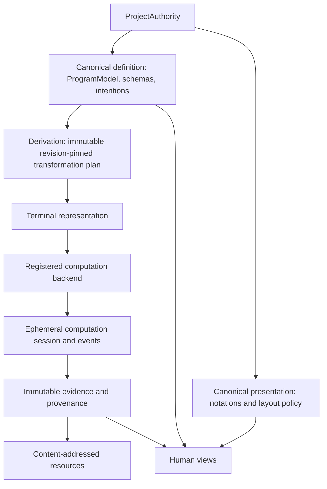

# Universal workbench boundaries — version 1

The authority owns authored meaning and authored presentation policy. Derived
models, computation sessions, observations, and bulk resources have distinct
lifetimes. A domain decides what an object means; the workbench does not classify
electrons, wires, fields, motors, or neurons.

"Universal" describes these semantic boundaries. This is a Python-native product:
Python implements the editor, orchestration and backend adapters. ProgramModel
models Python programs deeply; it is not a universal language AST. A Python solver
can consume a domain-specific IR directly. Foreign implementation details, if ever
needed, stay behind a Python adapter. Internal calls do not round-trip through
Protobuf; durable resources, workers and network contracts use it at real boundaries.

## Retained contracts

ProgramModel remains the specialized canonical programming domain. Generic
schemas and instances represent other authored meaning, with one containment
owner and stable references. SemanticProgram remains a derived index;
SemanticConcept remains an authored grouping. ProjectionDefinition remains a
query/lens policy; NotationDefinition supplies presentation and editing policy.
All edits still enter the existing authority, revisions, command journal and
undo/redo system. A relationship with properties or invariants of its own is an
ordinary intentional object with reference roles, not a universal connection.

The existing transformation graph already supports schema-scoped intermediate
languages. The extension adds terminal backend selection instead of requiring
every computation to terminate at ProgramModel. Python generation, invocation,
source maps and debugging remain the existing implementation behind its backend.

## Closed values, resources and persistence

CanonicalValue version 1 is a closed sum of text, boolean, integer, real,
complex, quantity, small tensor and resource reference. Existing Python scalar
representations are retained; immutable value classes implement the additional
variants. This is a uniform contract, not a forced rewrite of mature storage.
None continues to mean absent/unset. All values are finite, integers and text
are bounded, and inline tensors have at most 1,024 elements and 16 axes.
Quantity magnitude is numeric, never recursively an arbitrary canonical value.
Property contracts may constrain a dimension, tensor dtype and tensor shape.
Dimensions use basis identities; physical interpretation and conversion belong
to domain extensions.

Large data lives in a content-addressed resource store. Canonical objects hold
immutable resource references; descriptors identify content hash, media type,
size and optional typed tensor structure. Reading a resource verifies its hash.
Rendering a resource or deriving a mesh never makes that presentation canonical.
Evidence is immutable and separate from project author state. Promoting an
observation into an authored property is an explicit authority command.

project.json remains canonical, human-readable, source-controlled metadata.
The native format revision changes only to admit the new typed values and
contracts; old scalar projects retain their meaning. Transformed models are
never saved as authored ProgramModel. Resource bytes and evidence records are
stored separately and referenced by identity and content hash.

## Computation and evidence

A prepared computation pins project revision, input objects, terminal
representation, transformation versions and immutable origins. Backends are
registered statically at application composition. Missing or ambiguous backend
paths are diagnostics. No project-controlled imports or executable callbacks
are persisted. The backend returns observations; admission validates revision,
backend and origin identities before existing semantic views can decorate them.
Evidence preserves input resources, configuration, seed where applicable,
outputs and transformation provenance. It does not silently change input state.

## Foundations

foundation.math@1 supplies mathematical expression objects rather than Python
source strings. foundation.space@1 supplies spaces, axes, frames and locations.
Their concepts, validators and computations live in extensions. The kernel
knows typed values and reference structure, not their mathematical or physical
interpretation. Additional foundations can evolve without kernel concept enums.

## Language-neutral boundary

Versioned Protobuf contracts encode identity/revision, values, domain structures,
resources, computation, evidence and typed commands. Python domain classes are
the ontology implementation; generated messages are boundary encodings. There
is no Any, Struct, arbitrary callback or opaque JSON escape hatch. Unsupported
versions, variants and unknown fields are rejected before mutation rather than
silently losing semantics. Missing domain implementations preserve authored data.

Field numbers are never reused. Code generation and runtime versions are pinned.
Lossless round-trip tests cover every admitted value and contract. The initial
portable command vocabulary is explicit; unsupported command families continue
to use the existing native API until a typed wire contract is defined.

Resource hashes are hashes of bytes. Evidence and descriptor identities use an
explicit versioned semantic encoding, not Protobuf serialization: even
deterministic Protobuf output is [not a canonical serialization format](https://protobuf.dev/programming-guides/serialization-not-canonical/).
Wire evolution and the project file format remain independent decisions.

## Dependency direction and invalid states

Domain contracts import no Qt, application, execution or Protobuf code.
Persistence/protocol adapters depend on domain types. Backends and extensions
implement registered interfaces; the authority coordinates existing commands.
Invalid states include oversized inline values, nonfinite numbers, incompatible
property contracts, dangling resource handles, hash mismatch, unowned/cyclic
containment, unknown schema/backend versions, ambiguous transformation paths,
stale evidence admission and unresolvable origins. None is repaired by copying
another representation back into canonical state.

## Cutover and proof

The ecosystem boundary is now specified by [Contract identities](CONTRACT_IDENTITIES.md),
[Foundation units](FOUNDATION_UNITS.md), [Computation backends](COMPUTATION_BACKENDS.md)
and [Resources and evidence](RESOURCES_AND_EVIDENCE.md). Publication distinguishes
host-granted public names from private/project IDs. Ordinary unit vocabularies,
cooperative backend lifecycles and streamed resource transport participate in the
same architecture; CanonicalValue and ProgramModel retain their existing invariants.

Implement and verify values/resources first, then executable protocol adapters,
then terminal computation and evidence, then ordinary foundations. A structured
math computation provides a direct Python-adapter proof with immutable output and original
intentional identities. Existing Python/example/runtime tests remain regression
requirements. No new authority, plugin loader or parallel application is added.
